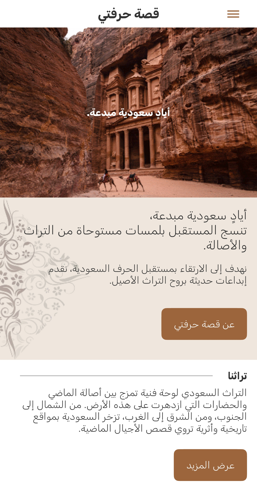
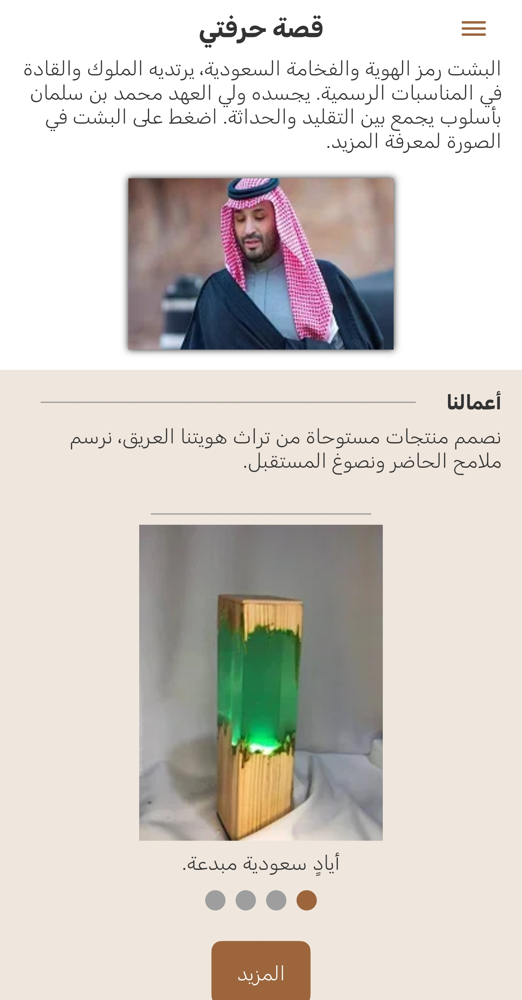
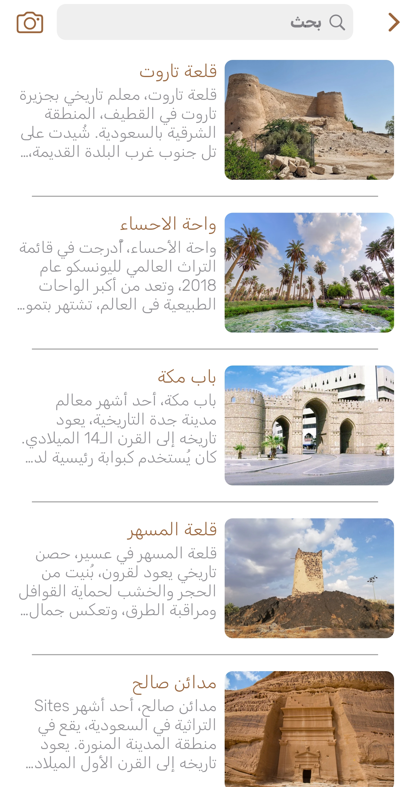
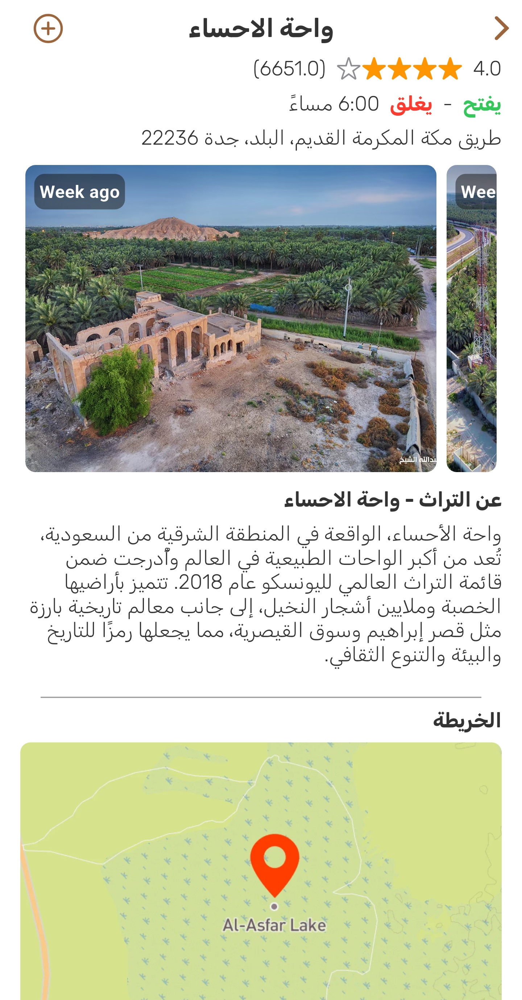
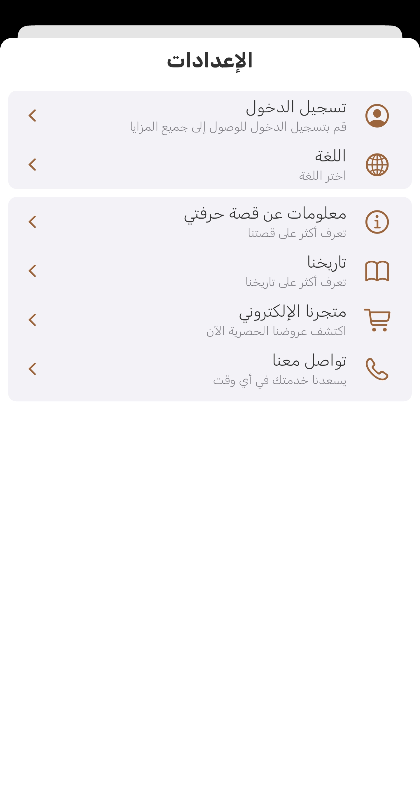
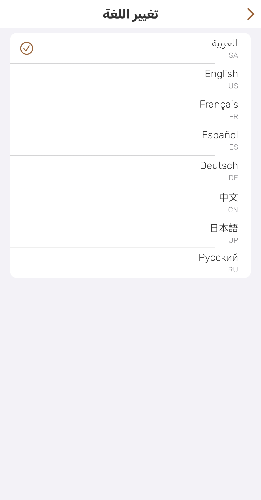
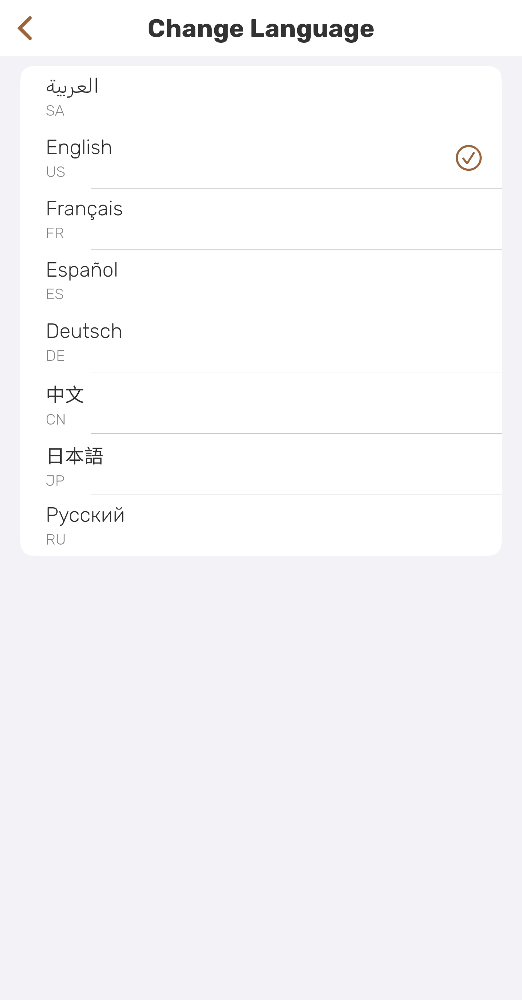
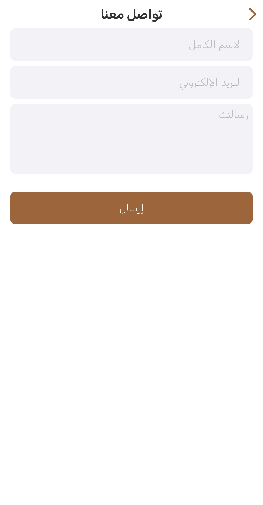
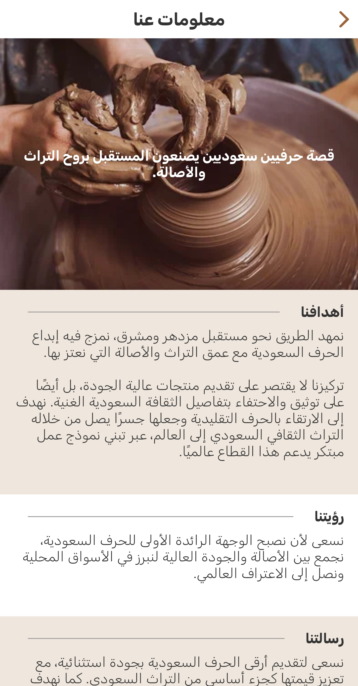

# Qissat Hirfati (قصة حرفتي)

  

  <em>Creative Saudi hands, weaving the future with touches inspired by heritage and authenticity.</em>

  
  
  

## 🚀 About The Project

**Qissat Hirfati** (The Story of My Craft) is a mobile application dedicated to celebrating and promoting the rich heritage of Saudi Arabian handicrafts. The app serves as a digital bridge connecting the authenticity of traditional crafts with modern design, creating a unique platform that supports local artisans and shares the vibrant Saudi culture with the world.

Explore historical landmarks, uncover the stories behind the crafts, and purchase unique, high-quality products directly from talented Saudi "Production Families."

## ✨ Key Features

- **Explore Saudi Heritage:** Discover detailed information and captivating stories about iconic Saudi heritage sites and their cultural significance.
- **Curated Online Store:** Browse and purchase authentic handcrafted products directly from talented local artisans.
- **Multilingual Support:** Fully localized in 8 languages, including Arabic and English, to welcome a global audience.
- **Personalized Experience:** Secure user authentication allows for a customized and engaging journey within the application.
- **Seamless User Experience:** A clean, intuitive, and responsive interface designed for ease of use on all mobile devices.

## 📸 Screenshots

| Screenshot                                                                             | Screenshot                                                                             | Screenshot                                                                             |
| -------------------------------------------------------------------------------------- | -------------------------------------------------------------------------------------- | -------------------------------------------------------------------------------------- |
|  |  |  |
|  |  |  |
|  |  |  |
